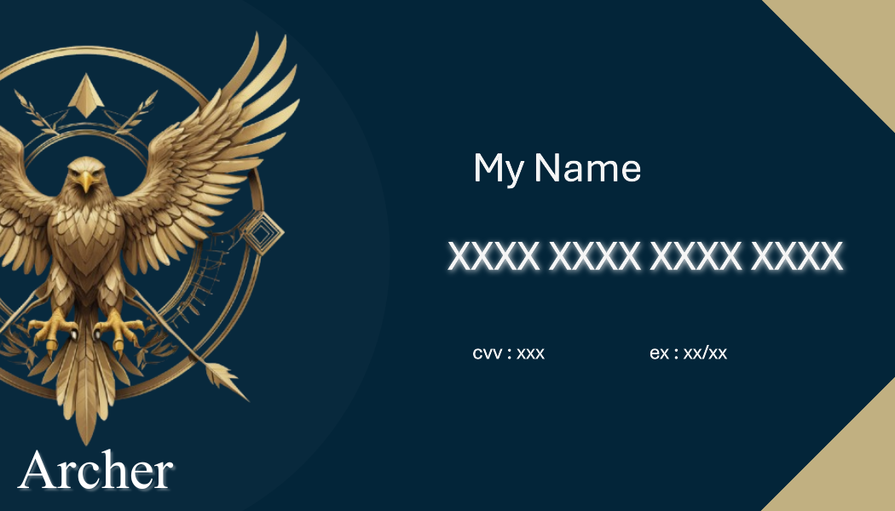

# 🦅 ArcherE-Bank
### A full-stack banking-interface learning prototype

**Next.js · React · TypeScript · Express · MySQL · Socket.IO**

[📚 Docs](docs/README.md) · [🗺️ Roadmap](ROADMAP.md) · [🔐 Security](SECURITY.md) · [🤝 Contributing](CONTRIBUTING.md)

> [!CAUTION]
> **Educational prototype only. Not a bank or payment service. Never enter real passwords, identity records, card details, CVVs, customer data or money.** Static inspection found critical credential, authorization, card-data and transaction-integrity weaknesses. Do not deploy this code to handle real users or funds.

## 🖼️ Existing visual assets\n\nThese are repository artwork assets, not screenshots of a verified running application.\n\n
\n\n\n
\n\n## 🧭 Contents
- [🌟 Overview](#-overview)
- [🎯 Problem and objectives](#-problem-and-objectives)
- [✨ Features](#-features)
- [🧰 Technology stack](#-technology-stack)
- [🏗️ Architecture](#️-architecture)
- [🔄 Workflows](#-workflows)
- [📂 Project structure](#-project-structure)
- [🚀 Installation](#-installation)
- [⚙️ Configuration](#️-configuration)
- [🖥️ Usage](#️-usage)
- [🔌 API](#-api-and-realtime-events)
- [🗄️ Database](#️-database)
- [🧪 Testing](#-testing)
- [🔐 Security](#-security)
- [🗺️ Roadmap](#️-roadmap)
- [📚 Documentation](#-documentation)
- [🤝 Contributing](#-contributing)

## 🌟 Overview

ArcherE-Bank is a banking-themed full-stack web application prototype. The frontend uses Next.js, React, TypeScript and CSS Modules. A separate Express backend exposes HTTP endpoints, persists prototype records in MySQL and uses Socket.IO for realtime dashboard activity.

The source contains registration/login screens, card-style visuals, a dashboard, transfer and payment-request interactions, activity history and notification events. It is useful for studying how browser UI, API, relational database and realtime communication fit together.

### 🎯 Problem and objectives

A stateful application coordinates user input, identity, persistent records, business rules, asynchronous operations and updates across connected clients. A banking-style example makes these engineering concerns visible and demonstrates why financial-like workflows require stronger controls than ordinary CRUD.

Objectives:
1. Demonstrate frontend/backend separation.
2. Connect UI forms to SQL-backed HTTP endpoints.
3. Model transfer and payment-request states.
4. Present account activity and realtime notifications.
5. Document actual source structure and developer setup.
6. Identify controls required before any real financial use.

## ✨ Features

| Area | Implementation observed | Qualification |
|---|---|---|
| 🏠 Landing | Next.js home, header, footer and About | Present |
| 🧾 Registration | Form and POST /register | Plaintext password storage |
| 🔑 Login | Form and POST /login | Session model needs replacement |
| 💳 Card-style UI | Templates and generated values | Demo only |
| 📊 Dashboard | Account, transfer, request and activity UI | Needs local verification |
| 💸 Transfers | Balance/history writes | Not atomic |
| 📩 Requests | Create, list, accept and reject | Authorization gaps |
| ⚡ Realtime | Socket.IO activity/notifications | Client-asserted identity |
| 🗃️ Persistence | MySQL tables created at startup | No migration framework |

## 🧰 Technology stack

| Technology | Purpose |
|---|---|
| [Next.js](https://nextjs.org/) | Frontend framework/App Router |
| [React](https://react.dev/) | UI components |
| [TypeScript](https://www.typescriptlang.org/) | Frontend language |
| CSS Modules | Component styling |
| [Node.js](https://nodejs.org/) | Backend runtime |
| [Express](https://expressjs.com/) | HTTP API |
| [MySQL](https://www.mysql.com/) | Relational database |
| [Socket.IO](https://socket.io/) | Realtime events |
| npm | Dependency management |

## 🏗️ Architecture

~~~mermaid
flowchart TB
    U([👤 User]) --> B[🌐 Browser]
    B --> FE[🖥️ Next.js App Router React + TypeScript]
    FE -->|HTTP / cookies| API[🔌 Express API :5555]
    B <-->|Socket.IO| RT[⚡ Realtime server]
    API -->|SQL| DB[(🗄️ MySQL)]
    RT --> API
~~~

### 🔁 Request lifecycle

~~~mermaid
sequenceDiagram
    actor User
    participant UI as Next.js
    participant API as Express
    participant DB as MySQL
    User->>UI: Submit form
    UI->>API: HTTP request
    API->>DB: Parameterized SQL
    DB-->>API: Query result
    API-->>UI: JSON/status
    UI-->>User: Update interface
~~~

### 💸 Current transfer sequence

~~~mermaid
flowchart TD
    A([Submit transfer]) --> B[Resolve recipient]
    B --> C[Resolve source using supplied key]
    C --> D{Balance sufficient?}
    D -->|No| E[Return error]
    D -->|Yes| F[Debit source]
    F --> G[Credit recipient]
    G --> H[Insert history]
    H --> I[Emit dashboard updates]
~~~

> [!WARNING]
> This is the current sequence, not a safe financial design. Debit, credit and history are independent writes. A failure can leave inconsistent state. Future work needs one transaction, locking, idempotency and a ledger.

### 🔐 Current login flow

~~~mermaid
flowchart TD
    A([Login page]) --> B[Enter national ID and password]
    B --> C[POST /login]
    C --> D[Compute SHA-256]
    D --> E[Query matching user]
    E --> F{Match?}
    F -->|No| G[401 response]
    F -->|Yes| H[Set user_key cookie]
    H --> I[Dashboard]
~~~

The digest is unsalted SHA-256 and the cookie is not a complete secure session design. See [Security review](docs/security.md).

## 🔄 Workflows

~~~mermaid
stateDiagram-v2
    [*] --> Pending: request created
    Pending --> Accepted: recipient accepts
    Pending --> Rejected: recipient rejects
    Accepted --> [*]
    Rejected --> [*]
~~~

## 📂 Project structure

~~~text
ArcherE-Bank/
├── .github/
│   ├── ISSUE_TEMPLATE/
│   ├── workflows/
│   └── PULL_REQUEST_TEMPLATE.md
├── app/
│   ├── account/                 # Login and registration
│   ├── components/              # Shared landing components
│   ├── dashboard/               # Dashboard/activity UI
│   ├── css/                     # CSS Modules
│   ├── layout.tsx
│   └── page.tsx
├── docs/
│   ├── adr/                     # Architecture decisions
│   ├── diagrams/                # Mermaid sources
│   ├── runbooks/                # Operational procedures
│   └── *.md
├── public/
│   ├── banar/                   # Existing banner artwork
│   ├── logo/
│   ├── visa_card/
│   └── visa_card_temblete/
├── server/
│   ├── db.js
│   ├── server.js
│   └── package*.json
├── README.md
├── SECURITY.md
└── CONTRIBUTING.md
~~~

See [Project structure](docs/project-structure.md). Existing asset directory spellings are preserved.

## 🚀 Installation

Requirements: compatible Node.js, npm, MySQL, Git and a modern browser.

~~~bash
git clone https://github.com/Brajesh31/ArcherE-Bank.git
cd ArcherE-Bank
npm ci
~~~

Create a disposable database:

~~~sql
CREATE DATABASE archerbank CHARACTER SET utf8mb4 COLLATE utf8mb4_unicode_ci;
~~~

Create server/.env locally:

~~~dotenv
DB_HOST=127.0.0.1
DB_USER=archer_dev
DB_PASSWORD=replace_with_local_password
DB_NAME=archerbank
~~~

Start backend:

~~~bash
cd server
npm ci
npm start
~~~

Start frontend in another terminal at repository root:

~~~bash
npm run dev
~~~

Open http://localhost:3000. Backend listens on port 5555. Build/lint:

~~~bash
npm run build
npx eslint .
~~~

The root lint script currently calls next lint. Verify compatibility with installed Next.js/ESLint versions. See [Installation](docs/installation.md).

## ⚙️ Configuration

| Variable | Consumer | Purpose |
|---|---|---|
| DB_HOST | server/db.js | MySQL host |
| DB_USER | server/db.js | MySQL user |
| DB_PASSWORD | server/db.js | MySQL password |
| DB_NAME | server/db.js | Database name |
| NEXT_PUBLIC_API_BASE_URL | Example frontend setting | Browser-visible API URL convention |

The backend port and CORS origin are hard-coded. NEXT_PUBLIC variables may be exposed to browsers and must never contain secrets. See [Configuration](docs/configuration.md).

## 🖥️ Usage

Start MySQL, backend and frontend. Explore registration/login with synthetic values only. Inspect dashboard, card-style visuals, transfer/request components and Socket.IO traffic using browser developer tools. Demo balances are not real funds. See [Usage](docs/usage.md).

## 🔌 API and realtime events

| Method | Endpoint | Current purpose |
|---|---|---|
| GET | / | Backend liveness |
| POST | /get_my_data | Account/card display data |
| POST | /register | Create user/card-style rows |
| POST | /login | Credential check and cookie |
| POST | /transfer | Balance/history writes |
| POST | /request | Create pending request |
| POST | /get_notification | Read requests |
| POST | /accept_request | Accept request |
| POST | /reject_request | Reject request |

Socket events: get_trades, trades_update, request_notification and rejected_notification. Protected routes currently trust client-supplied account identifiers. See [API reference](docs/api-reference.md).

## 🗄️ Database

The backend creates users, visa_info, transfer and request tables at startup. The current schema uses shared random codes and has no visible versioned migration process.

~~~mermaid
erDiagram
    USERS ||--|| VISA_INFO : shared_random_code
    VISA_INFO ||--o{ TRANSFER : sender
    VISA_INFO ||--o{ TRANSFER : recipient
    VISA_INFO ||--o{ REQUEST : participant
~~~

See [Database guide](docs/database.md). This conceptual model is not a recommended financial schema.

## 🧪 Testing

No automated test suite was present in the inspected original tree. Build success does not prove financial correctness. Priority tests: account ownership, invalid amounts, insufficient funds, duplicate submissions, concurrent transfers, rollback, request transitions, socket isolation and sensitive-field redaction. See [Testing](docs/testing.md).

## 🔐 Security

Static inspection identified plaintext password persistence, unsalted SHA-256, CVV-like data storage/response, client-supplied account identifiers, client-controlled socket identity and non-atomic transfer writes. Use synthetic data only. Do not deploy for real users, identity records, card data or money. Read [SECURITY.md](SECURITY.md) and [Security review](docs/security.md).

## 📦 Dependency health\n\nThe initial GitHub Actions audit of the existing locked dependencies reported 13 root production-tree vulnerabilities (2 critical) and 22 backend production-tree vulnerabilities (2 critical). No dependency versions or lockfiles were changed in this documentation update. Review [Security](docs/security.md) before using the application; do not apply breaking forced upgrades without testing.\n\n## ⚡ Performance and accessibility

No benchmark or completed accessibility audit is claimed. Measure API latency, query plans, bundle size, socket fan-out and history payload sizes. Review keyboard access, labels, contrast, focus, responsive layouts and live regions. See [Performance](docs/performance.md) and [Accessibility](docs/accessibility.md).

## 🗺️ Roadmap

| Priority | Focus | Completion evidence |
|---|---|---|
| 🔴 P0 | Credentials and sessions | Adaptive hashing, secure sessions, authorization tests |
| 🔴 P0 | Card-data minimization | No stored/returned CVV |
| 🔴 P0 | Financial correctness | Atomic ledger transfers and idempotency |
| 🟠 P1 | Engineering | Migrations, modular services and tests |
| 🟡 P2 | Product quality | Responsive and accessible UI |
| 🟢 P3 | Operations | Monitoring, backups and recovery |

See [ROADMAP.md](ROADMAP.md).

## 📚 Documentation

[Docs home](docs/README.md) · [Project overview](docs/project-overview.md) · [Architecture](docs/architecture.md) · [System design](docs/system-design.md) · [Structure](docs/project-structure.md) · [Workflow](docs/workflow.md) · [Data flow](docs/data-flow.md) · [Features](docs/features.md) · [Installation](docs/installation.md) · [Configuration](docs/configuration.md) · [Usage](docs/usage.md) · [API](docs/api-reference.md) · [Database](docs/database.md) · [Modules](docs/modules.md) · [Components](docs/components.md) · [Testing](docs/testing.md) · [Deployment](docs/deployment.md) · [Security](docs/security.md) · [Performance](docs/performance.md) · [Accessibility](docs/accessibility.md) · [Troubleshooting](docs/troubleshooting.md) · [FAQ](docs/faq.md) · [Limitations](docs/limitations.md) · [Future scope](docs/future-scope.md) · [Glossary](docs/glossary.md) · [References](docs/references.md)

## 🤝 Contributing

Read [CONTRIBUTING.md](CONTRIBUTING.md), follow [CODE_OF_CONDUCT.md](CODE_OF_CONDUCT.md), and use synthetic data exclusively. Security-sensitive changes need authorization, rollback and concurrency tests.

## 👤 Maintainer

**Brajesh Kumar** · [@Brajesh31](https://github.com/Brajesh31)

🦅 Learn full-stack engineering, document risks honestly and build responsibly.

Last updated: 2026-11-17 13:59 UTC
