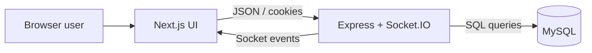
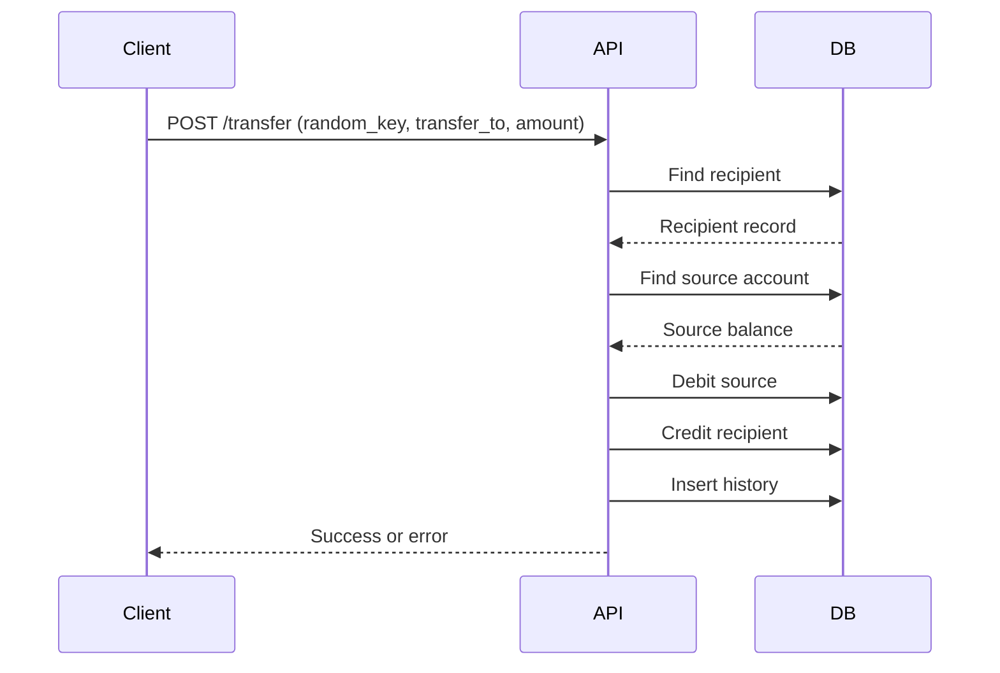

# 🔀 Data flow and trust boundaries

## Context diagram

## Information categories

| Data category | Current location | Sensitivity | Handling expectation |
|---|---|---|---|
| Name | User and card-like records | Personal | Minimize and authorize |
| National ID | User record | Highly sensitive | Do not use real identifiers in this prototype |
| Phone number | User and card-like records | Personal | Minimize and protect |
| Password | Registration request and current DB column | Credential secret | Never store plaintext |
| Password digest | User record | Credential verifier | Use adaptive password-specific hashing |
| Random account code | User/card records and client requests | Security-sensitive identifier | Do not treat possession as authorization |
| Card-like number | Card record and responses | Highly sensitive if real | Use payment tokenization; do not store raw PAN |
| CVV | Card record and response query | Highly sensitive | Never store CVV after authorization |
| Balance | Card-like record | Financial data | Make changes through atomic ledger operations |
| Transfer/request history | Transfer and request tables | Financial/personal | Enforce ownership and retention controls |

## Current transfer data flow

## Trust boundaries and risk statements

1. The browser is untrusted. Any account key or amount supplied by it must be validated and authorized server-side.
2. The HTTP process is a trust boundary. It must authenticate the caller before accessing account data.
3. The socket handshake is untrusted input. The current code uses its supplied code to associate a socket with account records.
4. The database must be protected with least privilege and parameterized queries. Parameter placeholders are visible in many current queries, but that alone does not solve authorization or business integrity.
5. Sensitive data must not appear in logs, screenshots, issue reports or demo fixtures.

## Recommended target flow

Authenticate the user, derive account identity from the verified session, validate a typed request, execute a domain service inside a database transaction, record ledger entries and audit metadata, commit, then publish an event through an outbox or post-commit dispatcher.
