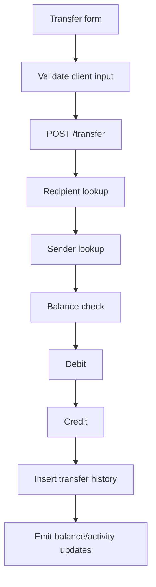

# 🔄 Application workflows

This document follows the route and event flow visible in `server/server.js` and the matching frontend feature areas. It describes current behavior and highlights where current behavior is not safe enough for production.

## Account registration

1. The user opens the registration page under `app/account/register/`.
2. The registration component collects name, password, national ID, phone number and selected card type.
3. The frontend sends a request to `POST /register`.
4. The backend generates a random account code and card-like number, expiry and CVV.
5. The backend inserts a user row, then a card-like row using the same account code.
6. The backend returns a success response if both operations complete.

**Failure concern:** the two inserts are not in a transaction. A partial registration can leave inconsistent records. The password is also currently inserted into a plaintext database column.

## Login

1. The login UI submits national ID and password.
2. The server hashes the submitted password with SHA-256.
3. The server compares the digest and national ID against `users`.
4. On a match, it sets a `user_key` cookie containing the account random code.

**Failure concern:** the code does not establish a complete secure session model. Password hashing and cookie configuration require redesign before real use.

## Transfer

The current transfer endpoint finds a recipient using phone/card value, fetches the sender by random code, checks a balance, issues a debit, issues a credit, inserts history, responds, and emits updates.

The sequence above is what the code attempts. It is vulnerable to partial updates and concurrent balance races because there is no encompassing transaction and row-lock strategy.

## Payment request

1. The requester submits a target phone/card value and amount.
2. The backend resolves the target account.
3. The backend loads requester profile information.
4. A pending request row is created.
5. A connected target socket may receive a request notification.

## Accept/reject request

- Accept: the backend loads a request addressed to the caller-provided account code, checks balance, subtracts from one account, adds to another, marks the request accepted, writes a transfer record, and emits updates.
- Reject: the backend marks the request rejected and may notify the requester.

**Failure concern:** the state transition and money movement are not atomic. Acceptance must be idempotent, authorized, and transactionally consistent.

## Realtime activity

A client emits `get_trades` with a code. The server reads matching transfers and balance and emits `trades_update`. It also iterates connected sockets to send notification/update events.

A secure design must derive socket identity from a verified session and authorize each room subscription on the server.
